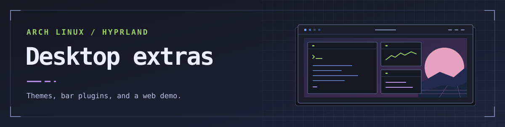
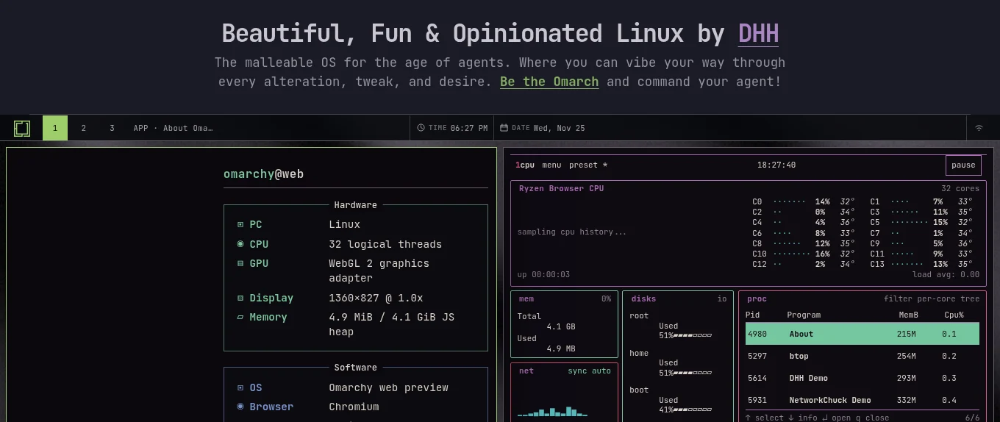
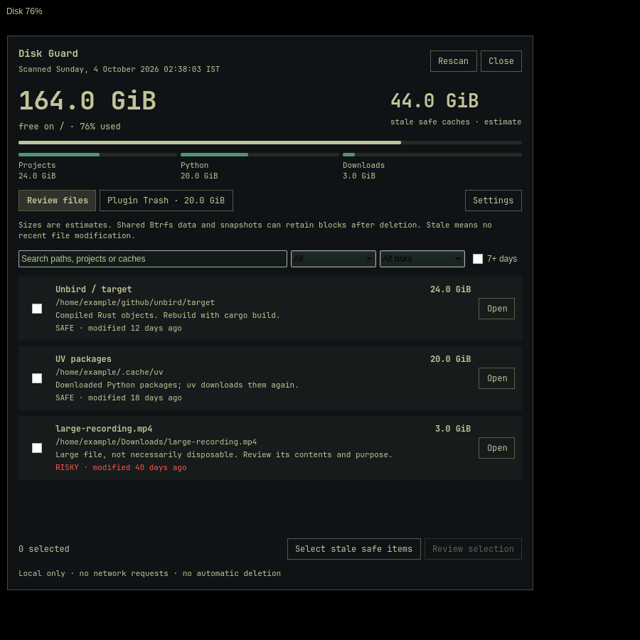

# Omarchy Extras



**Independent themes and Quickshell bar plugins for [Omarchy](https://omarchy.org), the Arch Linux desktop built around Hyprland.** Give your desktop a new look, prepare a bootable USB, or see what's using your disk space. You can also try the desktop in your browser.

[Catalog](#catalog) · [Install](#installation) · [Live demo](https://omarchy.palash.dev) · [Development](#development)

## Catalog

<table width="100%">
  <tr>
    <td width="50%" valign="top">
      <p><a href="https://github.com/debpalash/omarchy-gta6-theme/blob/f1eaa3c7c7eb8bfac1ef05e67f680124c314cf01/preview.png"></a></p>
      <p><strong>GTA VI Theme</strong><br>Give your desktop a new look with Vice Sunset and 15 alternate palettes.</p>
      <a href="#gta-vi-theme">Install theme</a> · <a href="https://github.com/debpalash/omarchy-gta6-theme">Theme source</a>
    </td>
    <td width="50%" valign="top">
      <p><a href="https://omarchy.palash.dev"></a></p>
      <p><strong>Omarchy Web Demo</strong><br>Try tiled windows, a keyboard launcher, and searchable docs in your browser.</p>
      <a href="https://omarchy.palash.dev">Try the demo</a> · <a href="DESIGN.md">Design notes</a>
    </td>
  </tr>
  <tr>
    <td width="50%" valign="top">
      <p align="center"><a href="https://github.com/debpalash/omarchy-bootable#screenshots"></a></p>
      <p><strong>Bootable</strong><br>Find a Linux ISO and prepare an installer USB from the Omarchy bar.</p>
      <a href="#bootable">Install plugin</a> · <a href="https://github.com/debpalash/omarchy-bootable">Plugin source</a>
    </td>
    <td width="50%" valign="top">
      <p align="center"><a href="docs/readme/disk-guard.png"></a></p>
      <p><strong>Disk Guard</strong><br>Find space used by caches, build artifacts, and downloads. Move selected items to recoverable Trash.</p>
      <a href="#disk-guard">Install plugin</a> · <a href="plugins/disk-guard/">Plugin source</a>
    </td>
  </tr>
</table>

## Installation

### GTA VI Theme

```bash
omarchy theme install https://github.com/debpalash/omarchy-gta6-theme.git
```

Vice Sunset is the default. [Browse the wallpaper editions](https://github.com/debpalash/omarchy-gta6-theme/blob/main/variants/README.md).

### Bootable

```bash
omarchy plugin add https://github.com/debpalash/omarchy-bootable.git --enable --yes
```

The full workflow requires Omarchy 4+ and Bootable 0.1.4+ with its helper and Polkit policy. Writing requires you to choose a removable drive and confirm the erase plan. [Requirements and updates](https://github.com/debpalash/omarchy-bootable#dependencies-and-permissions).

### Disk Guard

```bash
git clone https://github.com/debpalash/omarchy-extras.git
cd omarchy-extras/plugins/disk-guard
python3 install.py
```

Requires Omarchy's Quickshell plugin host and Python 3.11+. Scans stay on your machine. [Cleanup behavior and settings](plugins/disk-guard/README.md).

**Private companion plugins** · [Qwen Servers](https://github.com/debpalash/qwen-workspace) for local inference · [Android Emulator](https://github.com/debpalash/omarchy-android-emulator) for virtual devices

## Development

<details>
<summary>Run the website or load the theme and plugin sources</summary>

The web demo uses Solid 2, StyleX, and Vite with a Three.js desktop compositor. Use Node.js 22.12 or newer:

```bash
npm install
npm run dev
```

Run `npm run check` and `npm run build` before submitting site changes.

Bootable and GTA VI are pinned submodules. Disk Guard is tracked directly under [`plugins/disk-guard/`](plugins/disk-guard/). To load the submodules in a local clone:

```bash
git submodule update --init --recursive
```

</details>

---

Maintained by [Palash Deb](https://palash.dev) · [MIT license](LICENSE) · [Upstream website content](https://github.com/omacom/omarchy-site/tree/31a5ecd) · [Theme artwork credits](https://github.com/debpalash/omarchy-gta6-theme/blob/main/ASSETS.md)
